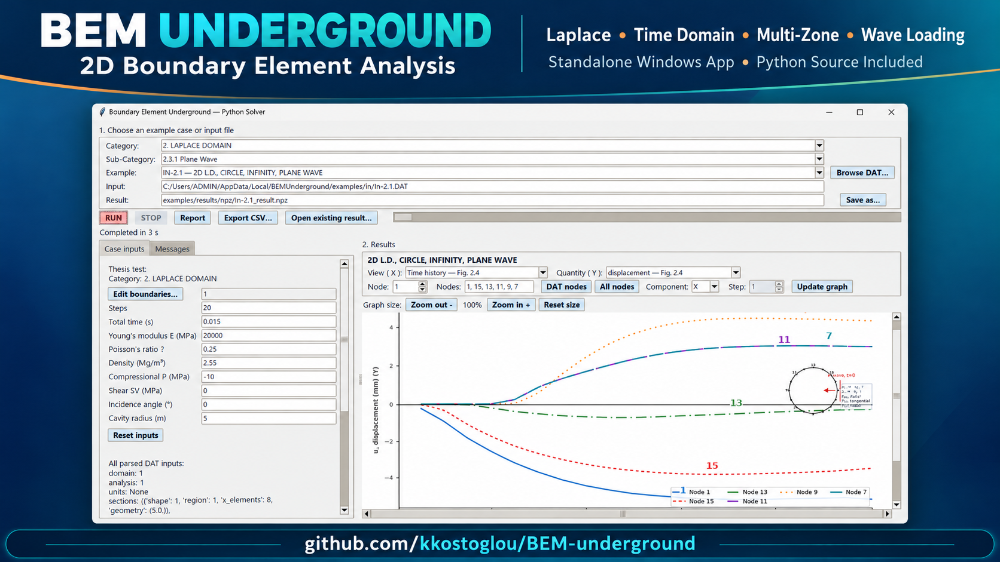

# BEM Underground

Python translation of a two-dimensional boundary-element program for underground cavities with friendly Graphics User Interface (GUI) for data input, with P & SV & explosive wave loading, and multi-zone analyses. The repository preserves the original Fortran material and thesis-based DAT examples alongside the Python solver. The executable can be downloaded from Releases section to the left. For any inquiries: kostoglou@yahoo.com


## Standalone Windows executable

A build recipe is available for running the GUI without installing Python. See
[WINDOWS_EXE.md](WINDOWS_EXE.md) for usage, data locations, and rebuild instructions.

## Install and run

For complete Windows Conda and Python virtual-environment instructions, Linux/macOS notes, verification commands, DAT examples, and troubleshooting, read [INSTALLATION.md](INSTALLATION.md).

On Windows, install Miniconda or Anaconda, then run from this directory:

```powershell
conda env create --prefix .\.conda-env --file environment.yml
.\RUN_BEM_GUI.cmd
```

The launcher uses `.conda-env\python.exe`, or `.venv\Scripts\python.exe` if Conda was not selected. For command-line execution with Conda:

```powershell
$env:PYTHONPATH = 'src'
& '.\.conda-env\python.exe' -m python 'examples\in\In-5.27-LD.DAT' --output 'examples\results\npz\In-5.27-LD_result.npz'
```

`examples/in/` contains the maintained DAT decks; `examples/in/Prev1992/` contains historical decks. DOMAIN 1 is Laplace-domain, DOMAIN 2 is direct time-domain, and DOMAIN 5 is convolution quadrature. Some preserved cases describe methods that have not yet been translated; consult `Documentation/TRANSLATION_GAPS.md` and the validation status notes under `Documentation/` before interpreting a result as a thesis reproduction.

## Documentation

- [Introduction (PDF)](Introduction.pdf)
- [Full thesis (PDF)](Documentation/Doc_KostasPhD.pdf)
- [User guide](USER_GUIDE.md)

## Repository contents

| Path | Purpose |
| --- | --- |
| `src/python/` | Python solver and GUI |
| `src/fortran-original/` | Original Fortran disks and source material |
| `examples/in/` | DAT inputs and manifest |
| `examples/reference/` | Thesis-figure index and Appendix F DAT guidance |
| `Introduction.pdf` | Project introduction |
| `Documentation/` | Full thesis PDF, original drawings, formulation and status notes |
| `USER_GUIDE.md` | Installation, DAT, GUI, and report guide |

Generated solver archives and PDF reports are intentionally excluded from this source bundle. The application creates `examples/results/` outputs when run. Historical validation notes are included under `Documentation/`; the comparison scripts and reference data they mention are not included in this checkout. Chapter 5, Chapter 6, and Appendix F are available in the full thesis PDF linked above.

This bundle does not include an installed Python environment. Create one locally with `environment.yml`. No license has been selected for this repository; add one only after deciding the distribution terms for the Python code, original Fortran material, and thesis documents.

## Upload to GitHub

See [GITHUB_UPLOAD.md](GITHUB_UPLOAD.md) for the prepared repository contents and upload commands.
